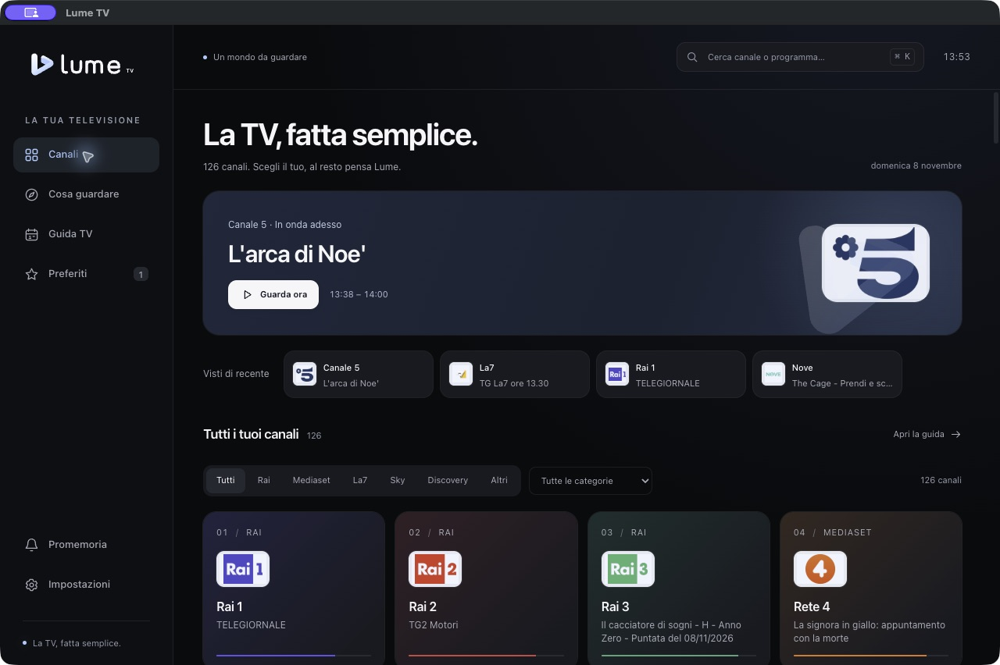

<p align="center">
  <picture>
    <source media="(prefers-color-scheme: dark)" srcset="web/app/assets/logo-light.svg">
    
  </picture>
</p>

<h1 align="center">La TV, fatta semplice.</h1>
<p align="center">Le dirette italiane sul tuo computer, con un’interfaccia essenziale e il player integrato.</p>
<p align="center">
  <a href="https://github.com/pjor94/LumeTV-Desktop/releases/latest">Scarica Lume TV</a> ·
  <a href="#compilazione">Compila dai sorgenti</a> ·
  <a href="docs/RELEASE.md">Pacchetti e release</a> ·
  <a href="docs/STATUS.md">Stato del progetto</a> ·
  <a href="CHANGELOG.md">Novità</a> ·
  <a href="CONTRIBUTING.md">Contribuisci</a> ·
  <a href="https://github.com/pjor94/LumeTV">Versione Android TV</a>
</p>

> [!NOTE]
> Lume TV Desktop è in sviluppo. Le prove di riproduzione disponibili riguardano
> **macOS Apple Silicon**; il collaudo video su Mac Intel, Windows e Linux resta aperto.
>
> [Compila e avvia l’app](#compilazione) · [Verifiche e limiti attuali](docs/STATUS.md)



Lume TV Desktop porta sul computer il catalogo di
[Lume TV per Android TV](https://github.com/pjor94/LumeTV). Scegli un canale,
apri la diretta a tutto schermo oppure continua a sfogliare con il mini-player.
Guida, ricerca e preferiti aiutano a ritrovare ciò che vuoi guardare.

Il backend è scritto in Rust, l’interfaccia in React e TypeScript. Il player usa
CEF incorporato e Shaka Player: puoi avviare Lume senza installare Chrome.

## Novità della 0.2.0

L’interfaccia passa a React mantenendo lo stile di Lume. Il player resta attivo
quando cambi pagina o passi al mini-player, senza riaprire la diretta.

La sezione **Radio** aggiunge 1.310 stazioni italiane di WorldRadio, con ricerca
per nome o città, preferite e recenti. Puoi continuare l’ascolto nel mini-player;
il titolo del brano compare quando viene comunicato dall’emittente.

Al primo avvio una schermata prepara Widevine prima di mostrare il catalogo.
Su macOS l’avvio evita la richiesta di accesso a “Chromium Safe Storage”.
Da **Impostazioni → Aggiornamenti dell’app** puoi controllare le nuove versioni,
scaricarle con una percentuale di avanzamento e scegliere quando installarle.
Le [note di versione](CHANGELOG.md) raccolgono tutte le modifiche.

## Grazie a WorldLiveTV

**Questo progetto esiste grazie al lavoro di
[WorldLiveTV](https://github.com/WorldLiveTV/WorldLiveTV.github.io) e di WLTV Group.**
Il catalogo delle sorgenti e le integrazioni delle emittenti derivano dal loro
add-on per Kodi, `plugin.video.wltvhelper`.

Lume TV ne ha adattato la logica per Android TV; questa versione la porta in
Rust e propone un’interfaccia dedicata al desktop. Il merito della raccolta e
della manutenzione delle sorgenti resta al progetto originale e ai suoi collaboratori.

Lume TV è un progetto indipendente, distribuito con licenza **GPL-3.0-or-later**.
Non è un’app ufficiale WorldLiveTV né delle emittenti. Versioni di riferimento,
file adattati e altre attribuzioni sono raccolti in
[THIRD_PARTY_NOTICES.md](THIRD_PARTY_NOTICES.md).

## Cosa offre

- Catalogo iniziale di **126 canali**, con Rai, Rai/TGR, Mediaset, La7, Sky,
  WBD/Discovery e le altre dirette supportate dalla lista WLTV.
- **1.310 radio italiane**, con catalogo aggiornabile, ricerca per nome e città,
  preferite, recenti e ascolto mentre navighi nell’app.
- Riproduzione di flussi HLS e DASH, con supporto Widevine quando richiesto
  dall’emittente e disponibile nel runtime.
- Player integrato, schermo intero e mini-player per continuare a guardare
  mentre esplori il catalogo o la guida.
- Ricerca per canale e programma, filtri per emittente e categoria, preferiti
  e canali visti di recente.
- Guida TV con programmi, orari e dettagli quando forniti dal palinsesto.
- **Cosa guardare**: programmi Ora/Tra poco/Stasera, ricerca e filtro preferiti.
- Promemoria locali per i programmi futuri mentre l’app è aperta.
- Scelta della qualità, volume, audio e sottotitoli quando disponibili.
- Tema chiaro, scuro o di sistema; navigazione da tastiera e animazioni
  che rispettano la preferenza per il movimento ridotto.
- Catalogo e guida aggiornati automaticamente, con cache locale conservata
  quando la sorgente non risponde.
- Preparazione iniziale di Widevine con stato dell’operazione e riprova in caso
  di errore.
- Aggiornamenti dell’app dalle release GitHub, con download annullabile e
  verifica dei pacchetti prima dell’installazione.

La disponibilità dipende dalle emittenti, dalla rete e dalle modifiche ai servizi
sorgente. Le prove di riproduzione coprono una parte dei canali del catalogo.

## Canali e Guida TV

Il catalogo raccoglie i canali con logo e programma in onda, quando disponibili.
Puoi cercare un nome, filtrare per emittente o categoria e premere la stella
per ritrovare un canale nei **Preferiti**. I **Visti di recente** permettono di
riprendere rapidamente una diretta.

La **Guida TV** mostra il palinsesto disponibile; i dettagli aiutano a scegliere
cosa guardare e a impostare un promemoria. **Cosa guardare** riunisce i programmi
nelle fasce **Ora**, **Tra poco** e **Stasera**. I promemoria vengono mostrati
mentre Lume è aperta.

Il catalogo viene controllato ogni 24 ore. Da **Impostazioni** puoi richiedere
manualmente l’aggiornamento della lista e della guida. Se il servizio richiede
una pausa o restituisce un errore, i dati già scaricati restano disponibili.
Non tutti i canali hanno una programmazione presente nella guida.

## Radio

Apri **Radio** nella barra laterale. La ricerca trova stazioni e città; i filtri
**Preferite** e **Recenti** raccolgono quelle che vuoi ritrovare. Il catalogo si
aggiorna ogni giorno e mantiene una copia locale quando la fonte non risponde.

Il player gestisce MP3, AAC e HLS. Mostra il titolo del brano quando la stazione
lo fornisce e tenta di riconnettersi in caso di interruzione, fino a tre volte.
Pausa, cambio stazione e chiusura del player annullano la riconnessione.
L’ascolto continua nel mini-player mentre l’app resta aperta. La disponibilità
delle singole radio dipende dalle sorgenti. Dettagli in [RADIO.md](docs/RADIO.md).

## Durante la diretta

Apri un canale dal catalogo e usa i controlli del player per regolare volume,
qualità, tracce audio e sottotitoli. Le opzioni effettivamente disponibili
dipendono dalla diretta.

Premi **Schermo intero**, il tasto **F** o fai doppio clic sul video per passare
al fullscreen; **Esc** permette di uscire. Se torni al catalogo o apri un’altra
sezione, la diretta continua nel mini-player. Puoi tornare al player principale
senza riaprire il flusso.

## Distribuzione e installazione

Scarica il pacchetto del tuo sistema da
[Release](https://github.com/pjor94/LumeTV-Desktop/releases/latest).
Ogni versione contiene l’app completa, il runtime CEF, i sorgenti corrispondenti
e i checksum. Le build dei singoli commit restano disponibili negli **Artifacts**
di [GitHub Actions](https://github.com/pjor94/LumeTV-Desktop/actions).

| Sistema | Pacchetto | Installazione |
| --- | --- | --- |
| macOS Apple Silicon | DMG o ZIP `macos-arm64` | Copia `Lume TV.app` in Applicazioni |
| macOS Intel | DMG o ZIP `macos-x64` | Copia `Lume TV.app` in Applicazioni |
| Windows x64 | ZIP `windows-x64` | Estrai tutta la cartella e avvia `LumeTV.exe` |
| Linux x64 / Ubuntu 24.04 | DEB o tar.gz `linux-x64` | Installa il DEB con il gestore pacchetti, oppure estrai il tar.gz e avvia `AppRun` |

I tag ordinari, come `v0.2.0`, producono una release normale. I tag con suffisso
`beta` o `rc` producono un’anteprima. Le istruzioni complete sono in
[pacchetti e release](docs/RELEASE.md).

I pacchetti sono ancora di sviluppo: macOS usa una firma ad hoc senza
notarizzazione e Windows non ha una firma Authenticode. La build dai sorgenti
rimane disponibile in [Compilazione](#compilazione).

| Piattaforma | Stato |
| --- | --- |
| macOS Apple Silicon | Build e finestra Rust/CEF eseguite; metriche di riproduzione verificate su Rai 1, Canale 5 e La7. |
| macOS Intel | DMG e ZIP compilati su runner nativo; controllo dei metadati dal pacchetto superato. Riproduzione da verificare. |
| Windows x64 | ZIP compilato su runner nativo con bootstrap sandbox; controllo dei metadati dal pacchetto superato. Riproduzione da verificare. |
| Linux x64 | DEB e tar.gz compilati su runner nativo; controllo dei metadati dal pacchetto superato. Riproduzione desktop da verificare. |

Le build includono CEF e gli avvisi dei componenti. Il controllo automatico
avvia l’eseguibile per leggerne i metadati; il collaudo della finestra e delle
dirette richiede una sessione grafica. Gli esiti sono in
[GitHub Actions](https://github.com/pjor94/LumeTV-Desktop/actions).

Nelle ultime prove macOS, i canali protetti hanno superato i controlli DRM e di
decodifica. Le catture mostrano però l’area video nera: resta da confermare
l’immagine sul monitor. I contatori audio misurano la decodifica; l’ascolto va
verificato a parte. Risultati, versioni e limiti sono in [Stato del progetto](docs/STATUS.md).

### Primo avvio e Widevine

Widevine non è incluso nei sorgenti né nel bundle. CEF può scaricarlo nel
profilo dell’app attraverso il proprio Component Updater. Al primo avvio una
schermata dedicata completa la preparazione prima di aprire il catalogo:
serve Internet e l’operazione può richiedere alcuni minuti.
Questo percorso è stato verificato su macOS, senza copia da Chrome.

Versioni, provenienza e aspetti ancora aperti per la distribuzione binaria sono
descritti nella [documentazione del player incorporato](docs/EMBEDDED.md#widevine-automatico-al-primo-avvio)
e nelle [attribuzioni](THIRD_PARTY_NOTICES.md).

### Aggiornamenti dell’app

Le nuove build controllano le release in background. In **Impostazioni →
Aggiornamenti dell’app** puoi scaricare il pacchetto con avanzamento, annullare
il download e scegliere quando installarlo. Firma Ed25519 e SHA-256 vengono
verificati prima dell’installazione. Preferiti e impostazioni restano salvati.

Su macOS e nelle cartelle portabili scrivibili, **Installa e riavvia** sostituisce
l’intero pacchetto e conserva una copia precedente. Il DEB di Linux apre il
gestore pacchetti; se la cartella dell’app non è scrivibile viene aperto il
pacchetto per l’installazione manuale. Per impostazione iniziale Lume propone
le release ordinarie. Puoi includere le anteprime attivando **Versioni di prova**.

La release 0.1.0 già pubblicata non ha questo controllo: occorre installare
manualmente la prima build che lo include. Catalogo, guida TV e Widevine si
aggiornano separatamente. Dettagli in [Aggiornamenti](docs/UPDATES.md).

## Tastiera

| Tasto | Azione |
| --- | --- |
| ⌘/Ctrl K | Porta il focus sulla ricerca |
| ⌘/Ctrl 1 | Apre Canali |
| ⌘/Ctrl 2 | Apre Cosa guardare |
| ⌘/Ctrl 3 | Apre Guida TV |
| ⌘/Ctrl 4 | Apre Preferiti |
| Spazio durante la diretta | Mette in pausa o riprende |
| M durante la diretta | Attiva o disattiva l’audio |
| F o doppio clic sul video | Entra o esce dallo schermo intero |
| ↑/↓ o Pagina su/giù durante la diretta | Passa al canale precedente o successivo |
| Esc | Esce dal fullscreen; fuori dal fullscreen chiude la ricerca o torna dal player alla sezione precedente |

Le scorciatoie della diretta agiscono nella vista del player, senza interferire
con la scrittura nei campi di ricerca. Le trovi anche in
**Impostazioni → Scorciatoie da tastiera**.

## Compilazione

Per il bundle macOS Apple Silicon servono **Rust 1.92+**, **Python 3.12+**, CMake,
Ninja e Xcode Command Line Tools. Il percorso di build usa esplicitamente il
toolchain Rust nativo ARM64:

```sh
rustup toolchain install stable-aarch64-apple-darwin --component rustfmt --component clippy
./scripts/build_embedded_macos.sh
open 'target/cef-obs-arm64/debug/Lume TV.app'
```

Lo script scarica l’SDK OBS CEF previsto dal progetto, ne verifica il checksum,
compila i binari e crea il bundle. Riproduzione e preparazione del CDM avvengono
al successivo avvio del player.
Le risorse della UI sono incluse nel binario: dopo una modifica occorre ricompilare.

Per contribuire, eseguire i test o lavorare sul core multipiattaforma, consulta
[CONTRIBUTING.md](CONTRIBUTING.md). Versioni e configurazione CEF sono in
[docs/EMBEDDED.md](docs/EMBEDDED.md); i controlli Linux sono in
[docs/LINUX.md](docs/LINUX.md). La preparazione del repository per GitHub è descritta
in [docs/PUBLISHING.md](docs/PUBLISHING.md).

<details>
  <summary>CLI, profili di sviluppo e verifiche automatiche</summary>

Il CLI senza CEF permette di elencare i canali e verificare resolver/manifest:

```sh
cargo run --locked -- channels
cargo run --locked -- probe --channel rai1
```

`probe` contatta la sorgente ma non riproduce il video. Dopo la build CEF,
`doctor`, `play` e `matrix` verificano runtime e riproduzione. La diagnostica con
un browser installato si seleziona esplicitamente con `--runtime browser`.
Il [protocollo di validazione](docs/VALIDATION.md) distingue i livelli di evidenza.

Per una sessione di sviluppo con profilo separato:

```sh
./target/cef-obs-arm64/debug/lume-player app --profile profiles/mio-test
```

`app --serve-only --profile profiles/ui-test` avvia soltanto l’anteprima HTTP locale.
L’interfaccia usa React e TypeScript, con gli stili originali di Lume. Per
modificarla servono Node 22.12+ e Python 3.12+. Il bundle compilato è conservato
nel repository: la compilazione Rust può usarlo anche senza Node.
La [guida al frontend](docs/FRONTEND.md) descrive componenti, player e build.

```sh
cd web/app
npm ci
npm run build
npm test
npx playwright install chromium
npm run test:browser
```

I test degli strumenti usano Python 3.12+.
Non sono dipendenze runtime dell’app.

```sh
python3 scripts/check_repository.py
cargo fmt --all -- --check
cargo test --locked --all-targets
cargo clippy --locked --all-targets -- -D warnings
node --test web/player.test.cjs
python3 scripts/check_frontend.py
python3 -m unittest discover -s tests -p 'test_*.py'
```

La CI verifica core Rust e API CEF sui tre sistemi, ricompila la UI e confronta
il risultato con gli asset incorporati. Esegue anche i test React nel browser
e quelli Python con fixture, poi costruisce i pacchetti su quattro runner nativi.
Usa Node 24 e Python 3.13; i test con fixture non contattano le emittenti e non
verificano la riproduzione live.

</details>

## Privacy

Lume TV non richiede un account. Preferiti, cronologia, guida e impostazioni
restano sul dispositivo; le sessioni dei provider sono gestite dal backend Rust.
L’app contatta i servizi di WLTV, EPG-Guide e delle emittenti, il servizio di
aggiornamento CEF per preparare Widevine e GitHub per controllare e scaricare
le nuove versioni del programma.

Preferenze e cache sono in `~/Library/Application Support/LumeTV` su macOS,
`%APPDATA%/LumeTV` su Windows e `$XDG_DATA_HOME/LumeTV` oppure
`~/.local/share/LumeTV` su Linux. `LUME_DATA_DIR` permette di scegliere un’altra
directory. Profili, cache, CDM e report grezzi restano esclusi da Git.
Per le segnalazioni di sicurezza consulta [SECURITY.md](SECURITY.md).

## Sorgenti e diritti

Lume TV è un client indipendente per la riproduzione di dirette televisive.
Le richieste partono dal dispositivo dell’utente; il progetto non ospita le
trasmissioni. Disponibilità e accesso dipendono dai servizi sorgente, dai diritti
territoriali e dalle condizioni applicabili.

La licenza del software non trasferisce diritti su trasmissioni, palinsesti,
marchi, loghi o componenti esterni. Provenienza e avvisi sono raccolti in
[THIRD_PARTY_NOTICES.md](THIRD_PARTY_NOTICES.md).

## Licenza

Il codice del progetto e le risorse originali di Lume TV sono distribuiti sotto
[GNU GPL versione 3 o successiva](LICENSE). Le integrazioni derivate da WorldLiveTV
mantengono la stessa licenza. Crediti, avvisi di modifica e licenze dei componenti
vendorizzati sono in [THIRD_PARTY_NOTICES.md](THIRD_PARTY_NOTICES.md).
La distribuzione dei binari richiede anche il rispetto delle condizioni dei
componenti CEF, codec e CDM scelti.
