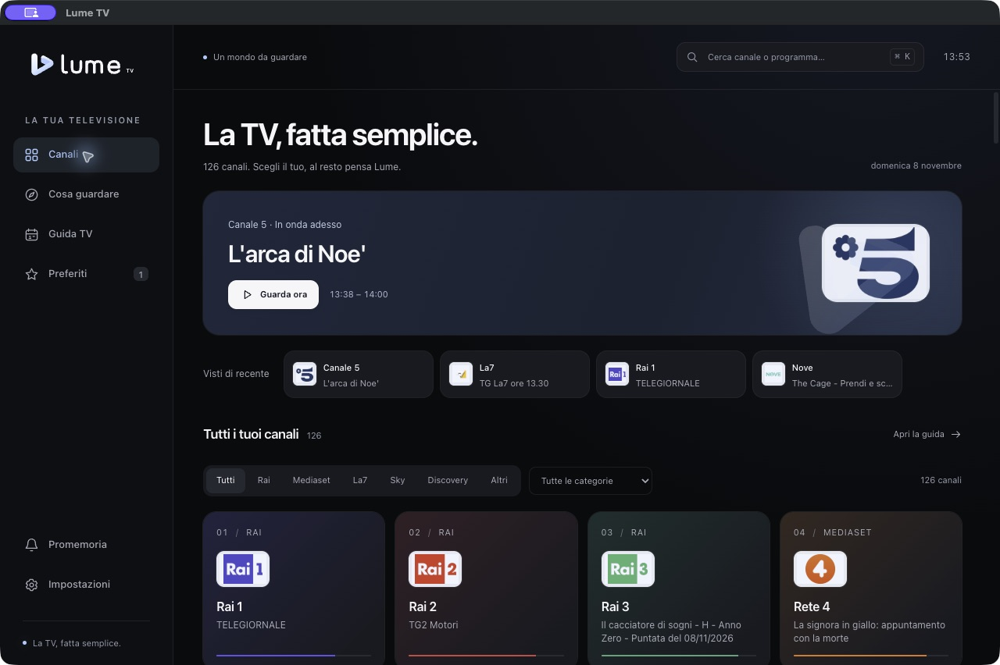

# Rifiniture UI e animazioni

Le rifiniture dell’8 novembre 2026 seguono le scelte descritte
nell’[analisi UI](../plans/ui-motion-audit.md). Il [riepilogo delle verifiche](STATUS.md)
raccoglie lo stato del progetto e i limiti delle prove.

## Comportamento

- Catalogo, guida, dettagli e lista del player sono componenti React con chiavi stabili. Focus, loghi già caricati e scroll vengono conservati durante gli aggiornamenti. Il componente video resta montato nello stesso punto dell’albero anche quando cambia la pagina.
- Il player passa alla modalità mini e ritorna in **280 ms**, animando il contenitore e compensando la trasformazione del video per conservarne le proporzioni. Un’inversione parte dalla posizione visibile corrente. Resize, fullscreen, chiusura e movimento ridotto terminano il raccordo e ripuliscono gli effetti.
- I dettagli usano il dialogo HTML nativo: ingresso **220 ms**, uscita **140 ms**, gestione del focus conservata. Le opzioni entrano in **160 ms** ed escono in **120 ms**, con origine in basso a destra.
- La stella conferma la modifica in **140 ms**; i messaggi entrano in **180 ms** ed escono in **140 ms**. Le animazioni non rilanciano l’ingresso dell’intera griglia.
- All’avvio, il simbolo nell’introduzione compie un breve movimento prospettico, una sola volta. Curve e durate sono definite in `motion.css` e lette anche dal controller JavaScript.
- Ricerca, zapping e azioni da tastiera restano immediati. Con movimento ridotto vengono rimossi spostamenti e inclinazioni; le superfici mantengono una dissolvenza di **100 ms**. La rimozione di un preferito da tastiera passa il focus al vicino rimasto.
- I titoli dei programmi occupano fino a due righe e i metadati sono più leggibili. I recenti hanno una barra compatta; nelle finestre basse l’introduzione occupa meno spazio. Il testo di ripiego dei loghi scompare quando l’immagine è caricata, senza sovrapposizioni; lo stato viene conservato fra gli aggiornamenti.

Le animazioni sono in [motion.js](../web/app/src/motion.js) e [motion.css](../web/app/motion.css).
I componenti React le richiamano tramite riferimenti agli elementi. Il backend
incorpora il bundle statico descritto nella [guida al frontend](FRONTEND.md).

## Verifiche

Le prove dell’8 novembre, precedenti alla migrazione React, sono raccolte nel
report complessivo (`reports/motion-validation.json`). I test della migrazione
sono descritti nella [guida al frontend](FRONTEND.md).
I file in `reports/` restano locali ed esclusi da Git. Per ripeterle segui il
[protocollo di validazione](VALIDATION.md).

- **66 test Rust/CEF, 25 Node, 9 verifiche DOM in browser e 18 Python** superati; Clippy con `-D warnings`, formattazione e firma ad hoc del bundle verificati.
- I test Playwright in `web/app/tests` coprono identità del video e delle schede, preferenze, focus, dialoghi, fullscreen, inversione del mini-player e stati Widevine. Il server di fixture serve gli stessi file del bundle incorporato; non usa il server di sviluppo Vite. Il player simulato permette di verificare la UI, mentre le prove live restano separate.
- Rai 1, Canale 5 e La7 hanno superato 30 secondi misurati nella UI nativa macOS, con riduzione ed espansione del player. Widevine è verificato sui due canali protetti. Canale 5 è stato provato anche nella build finale e nel passaggio a fullscreen e ritorno.
- La preview HTTP con gli stessi asset è stata controllata nei temi chiaro/scuro e a **820 px**: nessun overflow orizzontale della pagina, due righe per i programmi e scroll iniziale corretto. Verificato anche il focus dopo la rimozione di un preferito mediante Invio.

Durante le prove automatiche l’audio era disattivato: la decodifica è stata misurata, mentre l’ascolto resta da verificare. I JSON riportano i contatori dei frame persi. Manca un profilo GPU con cui verificare l’obiettivo di 60 fps. Windows e Linux restano da collaudare in esecuzione.

Le catture di Canale 5 mostrano un’area video nera anche con decodifica, avanzamento e chiavi Widevine attivi. Il [riferimento tecnico Mozilla su Chromium](https://bugzilla.mozilla.org/show_bug.cgi?id=2075376#c2) descrive l’esclusione dei video protetti dalle catture macOS: è una possibile spiegazione del comportamento osservato. La conferma dell’immagine sul monitor resta da completare. Le catture disponibili mostrano soltanto l’interfaccia attorno al video protetto.

I testi funzionali troppo piccoli sono stati ingranditi e non risultano più tra i rilievi del controllo statico. Restano tre segnalazioni su elementi già presenti: pannello opzioni del player, fondo di caricamento e linee verticali della guida. Il pannello contiene i comandi sovrapposti al video; le linee delimitano gli intervalli orari. Non sono state aggiunte animazioni continue a questi elementi.

